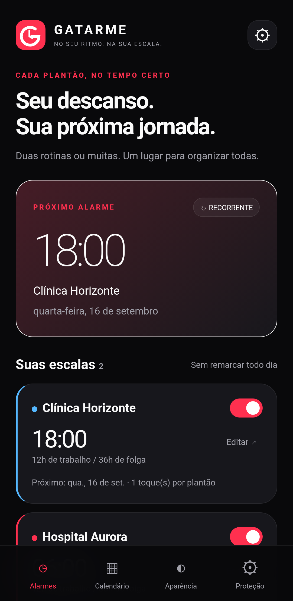
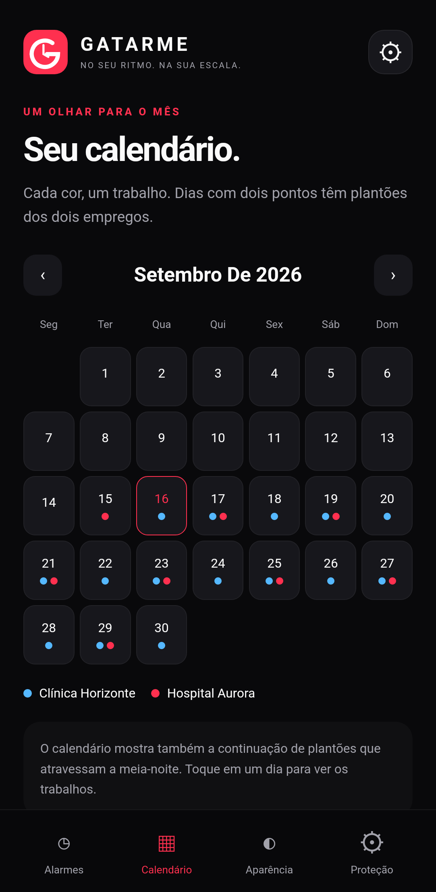

<p align="center"></p>
<h1 align="center">GATARME</h1>
<p align="center"><strong>No seu ritmo. Na sua escala.</strong><br>Despertador Android para quem trabalha em plantões, revezamentos e mais de um emprego.</p>
<p align="center"><a href="https://github.com/GABRIELMSORENSEN/GATARME/releases/latest">Baixar APK</a> · <a href="docs/USO.md">Como configurar</a> · <a href="docs/VALIDACAO.md">Validação e limitações</a></p>

<p align="center"></p>

## Feito para não remarcar todo dia

Cadastre o primeiro plantão de cada trabalho e o horário de despertar. O GATARME calcula os próximos automaticamente. **Desligar o toque de hoje não desativa sua escala.** A pausa permanente tem uma chave separada.

- Vários empregos independentes, com cores próprias e até 12 toques por plantão.
- Escalas 12×36, 12×24, 12×48, 12×60, 24×24, 24×48, 24×72, 24×96, 36×12, 48×96 e 8×16.
- Ciclos em dias: 5×2, 6×1, 4×2, 4×3, 2×2, 3×3, 5×1, 6×2, 4×4, 7×7, 14×14, 14×21, 21×21 e 28×28.
- Dias fixos da semana com horários diferentes por dia.
- Ciclos livres em horas/dias e sequência personalizada de trabalho/folga. Revezamento manhã/noite com um horário por posição do ciclo.
- Folgas extras e férias por datas. Calendário mensal que inclui plantões atravessando a meia-noite e sobreposição de empregos.
- Áudio do aparelho importado para o armazenamento do app, som padrão e reserva offline incluída.
- Seleção de vídeos do YouTube dentro do app. Player oficial em primeiro plano, **com internet e tela desbloqueada**. O áudio local permanece como reserva: não há download, extração de áudio nem reprodução garantida de YouTube com a tela bloqueada.
- Foto ou vídeo local como fundo da tela do alarme, mensagem, vibração e soneca de 1 a 60 minutos.
- Preto e vermelho por padrão; destaque, fundo, cartões e cores de texto configuráveis.
- Painel de proteção: alarmes exatos, notificações, tela cheia, bateria, volume e acesso opcional ao Não perturbe.

Os modelos cobrem escalas comuns; não existe uma lista finita de todas as convenções de trabalho. Use os ciclos livres e o revezamento para escalas específicas. O aplicativo organiza horários, sem validar regras trabalhistas.

## Instalar

1. Baixe `GATARME-v1.0.0.apk` em [Releases](https://github.com/GABRIELMSORENSEN/GATARME/releases/latest).
2. No Android, permita a instalação por essa fonte e abra o APK. Android **8.1 ou superior**.
3. Abra **Proteção**, conceda as permissões e use **Testar alarme em 15 segundos** com a tela bloqueada.
4. Cadastre cada emprego em **Alarmes → Adicionar escala**. Os horários de exemplo do README não são inseridos no aparelho.

> Um celular desligado, sem bateria, com volume de alarme zerado ou com o aplicativo em “Forçar parada” não oferece garantia de despertar. Reabra o aplicativo depois de forçar parada. No Samsung, inclua-o em **Aplicativos nunca suspensos** e teste seu modo Não perturbe. Nenhum aplicativo pode prometer funcionamento absoluto contra essas restrições.

## Exemplo: dois empregos 12×36

| Campo         | Trabalho A                 | Trabalho B                 |
| ------------- | -------------------------- | -------------------------- |
| Escala        | 12×36                      | 12×36                      |
| Primeiro dia  | Primeiro plantão real de A | Primeiro plantão real de B |
| Início        | 07:00                      | 19:00                      |
| Minutos antes | 60                         | 90                         |
| Despertar     | 06:00                      | 17:30                      |
| Cor           | Vermelho                   | Azul                       |

Cada ciclo de 12×36 repete o início a cada 48 horas. As datas iniciais definem a fase de cada emprego. Dois empregos não precisam começar no mesmo dia.

## Atualização 1.0.1

- A tela do alarme também abre sobre outros aplicativos com o celular desbloqueado. Em **Proteção**, permita **Abrir sobre outros apps**; sem essa permissão, o Android pode mostrar somente a notificação enquanto a tela estiver em uso.
- Para encerrar o toque, arraste o círculo até a direita. Toques e arrastos curtos não desligam o alarme. A soneca continua disponível e a escala permanece ativa.
- Leitores de tela têm a ação acessível “Parar este alarme”. A notificação abre os controles em vez de desligar com um toque.

A abertura usa a [permissão documentada pelo Android para iniciar uma atividade em segundo plano](https://developer.android.com/guide/components/activities/background-starts), exclusivamente quando um alarme dispara.

## Como funciona

Interface local HTML/CSS/JavaScript em WebView, com agendamento e reprodução nativos em Java. O alarme **não depende da WebView aberta**.

- `Schedule`: cálculo independente de Android, usando datas e horários civis no fuso do aparelho.
- `Scheduler`: `AlarmManager.setAlarmClock`, com uma próxima ocorrência exata por escala e uma soneca independente.
- `AlarmReceiver`: agenda a próxima ocorrência **antes** de iniciar o toque atual.
- `AlarmService`: serviço em primeiro plano, áudio de alarme em loop, vibração e notificação com ações. Alarmes simultâneos são atendidos em sequência.
- `RingActivity`: tela sobre o bloqueio para áudio local; foto/vídeo e controles. YouTube só é iniciado após desbloqueio.
- `RestoreReceiver`: restaura agendamentos no boot, atualização do pacote, mudança de hora/fuso e concessão da permissão.
- `Store`: dados e mídia em armazenamento protegido do dispositivo, acessível no boot antes do primeiro desbloqueio. Sem backup automático na nuvem.

A soneca não muda a data dos próximos plantões. Recorrências seguem o horário local em mudanças de horário de verão. Ciclos de dias têm duração máxima configurável de 168 horas por plantão; ciclos livres aceitam até 365 unidades de trabalho/folga (plantão contínuo em horas limitado a 168 h); sequências até 366 posições; até 50 escalas por instalação.

## Compilar e testar

Requisitos: JDK 17+, Android SDK 35, Python 3 para os scripts auxiliares. Gradle Wrapper incluído.

```sh
python scripts/test.py
./gradlew assembleDebug lintDebug
```

No Windows, use `gradlew.bat`. Configure `ANDROID_HOME` ou `local.properties` com `sdk.dir`. O APK de depuração fica em `app/build/outputs/apk/debug/`.

### Release assinada

Defina `GATARME_KEYSTORE`, `GATARME_STORE_PASSWORD` e `GATARME_KEY_PASSWORD` no ambiente. O alias esperado é `gatarme`.

```sh
./gradlew assembleRelease
```

Opcionalmente, `python scripts/build.py` lê essas variáveis de um JSON privado em `~/.gatarme-signing/signing.json` ou no caminho definido por `GATARME_SIGNING_CONFIG`. Sem chave configurada, a saída release é **não assinada**. Nunca envie chaves ou senhas ao repositório. Atualizações da versão distribuída precisam da mesma chave de assinatura.

## Privacidade

Sem conta, servidor próprio, anúncios próprios ou telemetria. Escalas e arquivos importados ficam no aparelho. Ao abrir o YouTube, o dispositivo se conecta ao Google/YouTube e se aplicam seus termos, cookies e política de privacidade. Leia [PRIVACY.md](PRIVACY.md).

## Referências técnicas

- [Android: alarmes e setAlarmClock](https://developer.android.com/develop/background-work/services/alarms)
- [Android: tela cheia e Android 14](https://developer.android.com/about/versions/14/behavior-changes-14)
- [YouTube: IFrame Player API](https://developers.google.com/youtube/iframe_api_reference)
- [YouTube: identificação do cliente em WebView](https://developers.google.com/youtube/terms/required-minimum-functionality)

## Licença

[MIT](LICENSE). Logo vetorial e som de reserva criados para este projeto.
